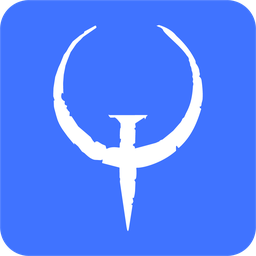

  

<h1 align="center">ioquakelive</h1>

  
  
  
  

Una implementación de código abierto de Quake Live, desarrollada por el equipo de [Quake Club](https://quakeclub.com). Reproduce la última versión original del juego (1069) sobre el motor [ioquake3](https://ioquake3.org/), incorporando mejoras propias y manteniendo la compatibilidad con el juego original.

El proyecto toma como punto de partida el trabajo de [Thomas Jones](https://github.com/tjone270/ioquakelive), cuya implementación sirvió de base e inspiración para continuar su desarrollo.

## Cómo jugar

Necesitarás una copia legítima de [Quake Live](https://store.steampowered.com/app/282440/Quake_Live/), ya que ioquakelive no incluye los archivos originales del juego, por lo que utiliza los de tu propia instalación.

1. Descarga la última versión desde [Releases](https://github.com/foressssst/ioquakelive/releases).
2. Extrae los archivos en la carpeta que prefieras.
3. Ejecuta `ioquakelive.x86_64.exe` para utilizar la versión OpenGL o `ioquakelive-vulkan.x86_64.exe` si prefieres Vulkan.

En Windows, el juego detecta automáticamente tu instalación de Quake Live y copia el archivo `pak00.pk3`. Si la detección automática no funciona, puedes copiarlo manualmente a la carpeta `baseq3`.

## Si el antivirus lo bloquea

ioquakelive es un proyecto nuevo y todavía no tiene firma digital, por lo que su reputación en Windows es baja y el navegador o Microsoft Defender pueden marcarlo como sospechoso. Suele pasar con cada versión nueva, hasta que más personas la descargan. No es un virus, el juego es de código abierto y cada versión se compila en GitHub desde este repositorio, así que descárgalo siempre desde [Releases](https://github.com/foressssst/ioquakelive/releases).

1. Si el navegador bloquea la descarga, elige "Conservar".
2. Si al abrirlo aparece "Windows protegió su PC", pulsa "Más información" y luego "Ejecutar de todas formas".
3. Si Microsoft Defender lo elimina, abre Seguridad de Windows, entra en "Historial de protección", selecciona el aviso y elige "Restaurar". Para que no se repita, agrega la carpeta del juego como exclusión en "Protección antivirus y contra amenazas".

## Características

- Compatibilidad con OpenGL, OpenGL 2 y Vulkan, con soporte para NVIDIA Reflex y AMD Anti-Lag 2 en Vulkan.
- Carga de recursos en varios hilos y FPS desbloqueados.
- Reproductor de demos mejorado.
- Integración con Quake Club.
- Nuevos comandos de consola: `help <comando o cvar>` y `searchconsole`.

## Agradecimientos

- [scryd1ke](https://github.com/scryd1ke), por sus aportes de código.
- [mmranni](https://github.com/mmranni), por sus pruebas y reportes.

## Créditos y licencia

Este proyecto también se basa en el trabajo de otros desarrolladores y proyectos de código abierto:

- [ioquakelive de Thomas Jones](https://github.com/tjone270/ioquakelive)
- [ioquake3](https://github.com/ioquake/ioq3)
- [Quake3e](https://github.com/ec-/Quake3e)
- [CPMA](https://playmorepromode.com/)

Quake Live y sus recursos pertenecen a id Software. El código fuente de este proyecto se distribuye bajo la licencia GPL v2.
